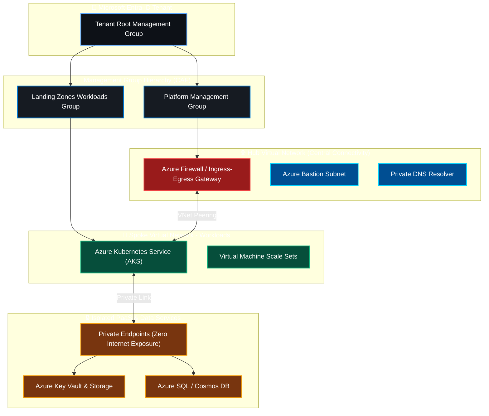

<div align="center">

<!-- Hero Dynamic Waving Banner -->


<!-- Dynamic Animated Typing Subtitle -->
<a href="https://github.com/AnilLatta">
  
</a>

<br />

<!-- Quick Navigation Bar -->
<p align="center">
  <a href="#about"><b>👨‍💻 About</b></a> •
  <a href="#impact"><b>⚡ Impact</b></a> •
  <a href="#blueprints"><b>🏛️ Architecture</b></a> •
  <a href="#arsenal"><b>🛠️ Tech Arsenal</b></a> •
  <a href="#projects"><b>🚀 Projects</b></a> •
  <a href="#telemetry"><b>📊 Telemetry</b></a> •
  <a href="#connect"><b>📫 Connect</b></a>
</p>

<!-- Live Badges & Counters -->
<p align="center">
  <a href="https://komarev.com/ghpvc/?username=AnilLatta&style=for-the-badge&color=0078d4">
    
  </a>
  <a href="mailto:anillatta170@gmail.com">
    
  </a>
  <a href="https://github.com/AnilLatta">
    
  </a>
  
  
</p>

---

</div>

<a name="about"></a>
## 👨‍💻 Executive Terminal & Cloud Identity

```bash
⚡(anil@cloud-core)-[~/infrastructure-core]
🚀$ ./launch-enterprise-inspection.sh --tenant azure-enterprise --iac-mode terraform --ai-tier modern

[✔] Cloud Mesh & Landing Zones: HEALTHY (Zero-Trust Security Policies Enforced)
[✔] Terraform Modules Ecosystem: 100% Reusable, Modular & Governed
[✔] CI/CD Automation Matrix: Azure DevOps (ADO) & GitHub Actions Operational
[✔] DevSecOps Shield Gates: Checkov, tfsec, Trivy & Secret Scanning [0 Criticals]
[✔] Infrastructure Drift Sentinel: ZERO DRIFT across all target environments
[✔] GenAI & Modern Ops Engine: ACTIVE | Accelerating Developer Velocity & Self-Healing
[✔] Target Status: 99.99% Availability Architecture | Multi-Region Paired DR
```

> *"Automate relentlessly. Treat infrastructure as versioned, immutable code. Shift security left before code ever touches production, and empower cloud operations with generative AI intelligence."*

I am a **Cloud Architect & DevSecOps Engineer** specializing in architecting resilient cloud platforms, automating infrastructure through enterprise-grade **Terraform Infrastructure-as-Code (IaC)**, and engineering end-to-end **Azure DevOps & GitHub Actions CI/CD pipelines**. 

My core focus spans designing scalable **Azure Landing Zones (CAF)**, implementing **Hub-and-Spoke enterprise networks**, establishing strict **Zero-Trust DevSecOps guardrails**, and pioneering the integration of **Generative AI & Agentic automation** to maximize developer velocity and system reliability.

---

<a name="impact"></a>
## ⚡ Quantified Scale & Engineering Impact

<div align="center">

| Pillar | Engineering Scale | Strategic Technical Impact |
| :--- | :--- | :--- |
| 🏗️ **Infrastructure as Code** | **Enterprise Terraform Modules** | Built modular, battle-tested IaC repositories enforcing state-locking, automated documentation, and strict validation. |
| 🛡️ **Shift-Left DevSecOps** | **Automated Security Gates** | Integrated SAST, container scanning, secret detection (Checkov, Trivy, Gitleaks) directly into PR pipelines to stop vulnerabilities pre-merge. |
| 🚀 **CI/CD Acceleration** | **Multi-Stage YAML Pipelines** | Engineered automated Azure DevOps & GitHub Actions workflows enabling automated testing, staging, and zero-downtime releases. |
| ☁️ **Cloud Networking & Security** | **Hub-and-Spoke Topology** | Deployed isolated virtual networks, Azure Firewall ingress/egress inspection, Network Security Groups, and Private Endpoints. |
| 🤖 **GenAI & Cloud Automation** | **Next-Gen Ops Workflows** | Built intelligent scripts and LLM integrations to automate log diagnostics, configuration generation, and operational tasks. |
| 📈 **High Availability & DR** | **Production SLA 99.99%** | Designed multi-region failover strategies, automated backups, and resilient compute clusters with geo-redundancy. |

</div>

---

<a name="blueprints"></a>
## 🏛️ Enterprise Architectural Blueprints

### 1. Enterprise Azure Landing Zone & Hub-and-Spoke Topology

Enforcing isolated workloads, centralized ingress/egress filtering via Azure Firewall, Private PaaS endpoints, and Azure Policy governance.



---

### 2. End-to-End Shift-Left DevSecOps CI/CD Pipeline

Zero-trust automated delivery engine running pre-commit checks, security scans, terraform plan approval, and automated deployments.

```mermaid
flowchart LR
    classDef dev fill:#161B22,stroke:#00D2FF,stroke-width:2px,color:#fff;
    classDef sec fill:#991B1B,stroke:#EF4444,stroke-width:2px,color:#fff;
    classDef iac fill:#004E92,stroke:#38BDF8,stroke-width:2px,color:#fff;
    classDef deploy fill:#064E3B,stroke:#10B981,stroke-width:2px,color:#fff;

    Code["Developer Commit"]:::dev --> Gate["PR Security Gate"]:::sec
    Gate --> Scan["Gitleaks & Checkov & Trivy"]:::sec
    Scan --> TFPlan["Terraform Plan & Drift Detection"]:::iac
    TFPlan --> Review["Peer Approval & Policy Gate"]:::iac
    Review --> Staging["Deploy to Staging Environment"]:::deploy
    Staging --> SmokeTest["Automated Verification Tests"]:::deploy
    SmokeTest --> Prod["Zero-Downtime Production Rollout"]:::deploy
```



---

<a name="arsenal"></a>
## 🛠️ Technical Arsenal & Skills Matrix

<div align="center">

### ☁️ Cloud & Virtualization
<p align="center">
  
  
  
  
  
</p>

### 🏗️ Infrastructure as Code (IaC)
<p align="center">
  
  
  
  
  
</p>

### 🚀 CI/CD, Containers & Orchestration
<p align="center">
  
  
  
  
  
  
</p>

### 🛡️ DevSecOps, Governance & Compliance
<p align="center">
  
  
  
  
  
  
</p>

### 📊 Monitoring, Observability & Reliability
<p align="center">
  
  
  
  
</p>

### 🤖 AI, Scripting & Languages
<p align="center">
  
  
  
  
  
</p>

</div>

---

<a name="projects"></a>
## 🚀 Featured Production & Open-Source Repositories

<div align="center">

| Repository | Tech Stack | Architectural & Operational Description |
| :--- | :--- | :--- |
| **[TerraformModules](https://github.com/AnilLatta/TerraformModules)** | `Terraform` `IaC` `Azure` | Reusable, production-ready enterprise Terraform modules enforcing state-locking, DRY architecture, and automated validation. |
| **[Ado-pipeline2026](https://github.com/AnilLatta/Ado-pipeline2026)** | `Azure DevOps` `YAML` `CI/CD` | Multi-stage Azure DevOps YAML pipeline framework embedding DevSecOps security gates, automated tests, and environment promotions. |
| **[GenAI](https://github.com/AnilLatta/GenAI)** | `GenAI` `Python` `AI Ops` | Next-generation Generative AI workflows, LLM automation tools, and agentic scripts to supercharge cloud engineering. |
| **[azuredev-5612](https://github.com/AnilLatta/azuredev-5612)** | `Azure` `Cloud Architecture` | Core Azure enterprise cloud platform provisioning with secure networking, identity governance, and workload isolation. |
| **[terraform_practice](https://github.com/AnilLatta/terraform_practice)** | `Terraform` `Multi-Env` | Advanced infrastructure orchestration patterns covering remote backends, workspace separation, and drift handling. |
| **[Terraform-1](https://github.com/AnilLatta/Terraform-1)** | `Terraform` `IaC Automation` | Automated cloud provisioning templates demonstrating automated resource lifecycle management and security hardening. |

</div>

---

<a name="telemetry"></a>
## 📊 Live Telemetry & GitHub Metrics

<div align="center">

<!-- GitHub Trophies -->
<a href="https://github.com/AnilLatta">
  
</a>

<br /><br />

<table border="0">
  <tr>
    <td width="50%">
      
    </td>
    <td width="50%">
      
    </td>
  </tr>
  <tr>
    <td colspan="2" align="center">
      
    </td>
  </tr>
</table>

<!-- Live Activity Graph -->
<a href="https://github.com/AnilLatta">
  
</a>

</div>

---

<a name="connect"></a>
## 📫 Connect & Collaborate

I am always keen to connect with fellow Cloud Engineers, Architects, DevOps Specialists, and Tech Leaders to discuss:
- 🌐 Designing enterprise **Azure Landing Zones & Secure Cloud Topologies**
- 🏗️ Building resilient **Terraform IaC modular frameworks**
- 🛡️ Shifting security left across **Azure DevOps & GitHub Actions CI/CD pipelines**
- 🤖 Integrating **Generative AI & Agentic automation** into production cloud workflows

<div align="center">

<p align="center">
  <a href="mailto:anillatta170@gmail.com">
    
  </a>
  &nbsp;
  <a href="https://github.com/AnilLatta">
    
  </a>
</p>

<br />

<p align="center">
  <i>"If it has to be run more than once, automate it. If it touches production, test and secure it. If it scales, engineer it as code."</i>
</p>

<p align="center">
  <strong>⭐ Star my repositories if you find my Terraform modules & DevOps pipelines useful! ⭐</strong>
</p>

<!-- Dynamic Footer Wave -->


</div>
