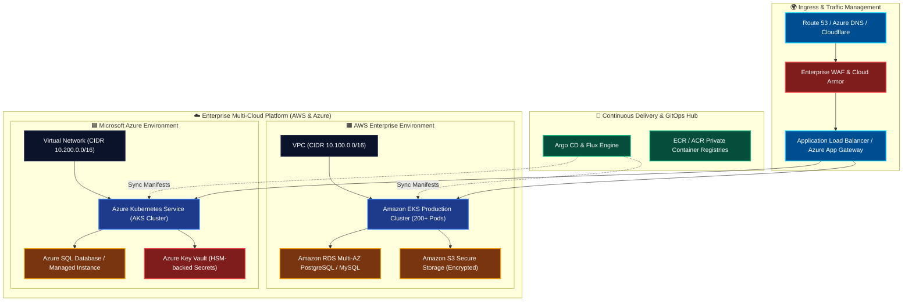
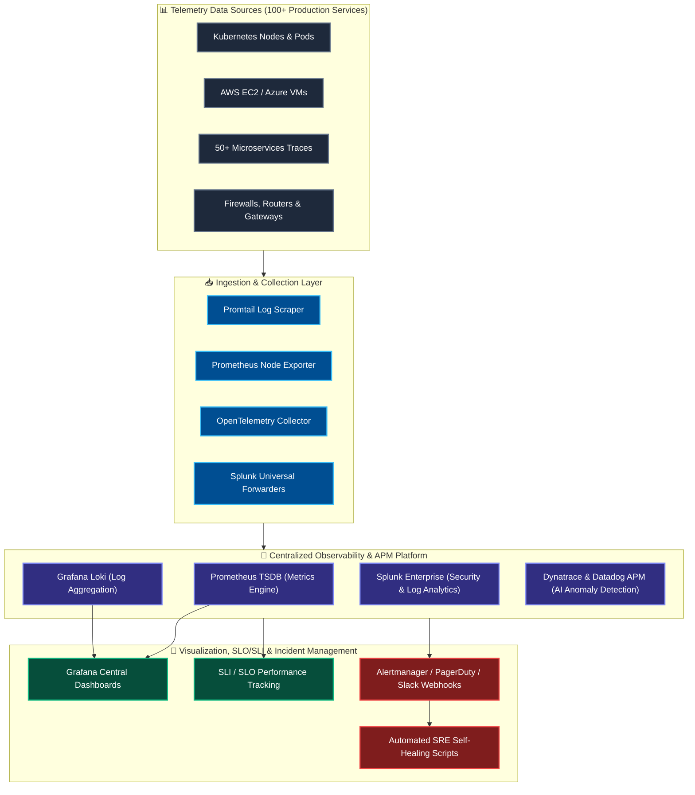

<div align="center">

<!-- Hero Dynamic Waving Banner -->


<!-- Dynamic Animated Typing Subtitle -->
<a href="https://github.com/AnilLatta">
  
</a>

<br />

<!-- Quick Navigation Bar -->
<p align="center">
  <a href="#about"><b>👨‍💻 Executive Summary</b></a> •
  <a href="#impact"><b>⚡ Quantified Impact</b></a> •
  <a href="#architecture"><b>🏛️ Architecture Blueprints</b></a> •
  <a href="#arsenal"><b>🛠️ Tech Arsenal</b></a> •
  <a href="#experience"><b>💼 Career Trajectory</b></a> •
  <a href="#casestudies"><b>📑 Case Studies</b></a> •
  <a href="#pillars"><b>🧱 10 Engineering Pillars</b></a> •
  <a href="#projects"><b>🚀 Projects</b></a> •
  <a href="#education"><b>🎓 Education</b></a> •
  <a href="#telemetry"><b>📊 Telemetry</b></a> •
  <a href="#connect"><b>📫 Connect</b></a>
</p>

<!-- Live Badges & Counters -->
<p align="center">
  <a href="https://komarev.com/ghpvc/?username=AnilLatta&style=for-the-badge&color=0078d4">
    
  </a>
  <a href="https://www.linkedin.com/in/anil-kumar-58a08b3b4/">
    
  </a>
  <a href="mailto:anillatta170@gmail.com">
    
  </a>
  <a href="tel:+917888496766">
    
  </a>
  
  
  
  
</p>

---

</div>

<a name="about"></a>
## 👨‍💻 Executive Summary & Cloud Leadership Identity

```bash
⚡(anil.kumar@enterprise-platform)-[~/cloud-core]
🚀$ ./verify-enterprise-platform.sh --scope reliance-enterprise --multi-cloud all --mode gitops

[✔] Cloud Mesh Core: AWS, Microsoft Azure & GCP [MULTI-REGION ACTIVE]
[✔] Kubernetes Orchestration: AKS, EKS & GKE Clusters Online (200+ Pod Scale)
[✔] Infrastructure as Code: 500+ Cloud Resources Governed via Terraform [ZERO DRIFT]
[✔] CI/CD & GitOps Delivery: 50+ Microservices Automated via Jenkins, GitHub Actions & Argo CD
[✔] DevSecOps Shield Gates: Trivy, Snyk, SonarQube & OWASP ZAP [0 CRITICALS ENFORCED]
[✔] Enterprise FinOps Engine: 30%+ Continuous Cloud Spend Reduction ($$$ Savings)
[✔] Full-Stack Observability: Prometheus, Grafana, Loki, Dynatrace & Splunk (100+ Services)
[✔] Disaster Recovery Sentinel: RPO < 15 Mins | RTO < 2 Hours [TESTED & VERIFIED]
[✔] Target Production SLA: 99.99% Availability across Enterprise Platforms
```

> *"Automate relentlessly. Treat infrastructure as versioned, immutable code. Enforce security gates before code reaches production, and build self-healing, cost-efficient cloud platforms that scale without friction."*

I am a **Senior DevOps & Cloud Engineer** with **16+ years of comprehensive IT industry experience**, including **8+ years dedicated exclusively to Cloud Architecture, DevOps, Platform Engineering, Infrastructure as Code, and Site Reliability Engineering (SRE)** within premier enterprise environments such as **Reliance Industries Limited** and **Reliance Jio Infocomm Limited**.

Throughout my career, I have orchestrated large-scale digital transformations, modernizing legacy enterprise applications into cloud-native microservices architectures across **AWS, Microsoft Azure, and Google Cloud Platform (GCP)**. My core expertise covers managing production-grade **Kubernetes clusters (AKS, EKS, GKE) at 200+ pod scale**, developing modular **Terraform Infrastructure as Code managing 500+ cloud resources**, building multi-stage **CI/CD and GitOps delivery pipelines (Jenkins, GitHub Actions, Argo CD, Flux)** supporting **50+ microservices**, and slashing release cycle times by **60%**.

Beyond automation, I am a committed champion of **DevSecOps** (shifting security left with Snyk, Trivy, SonarQube, and OWASP ZAP) and **FinOps** (cutting monthly cloud expenditure by **30%** via rightsizing, automated scheduling, and reserved capacity planning). Having started my journey with deep on-premise Linux kernel administration, storage networks, and telecommunications infrastructure, I bring a rare, full-spectrum architectural perspective that bridges bare-metal realities with cutting-edge multi-cloud, containerized platforms.

---

<a name="impact"></a>
## ⚡ Quantified Scale & Engineering Impact

<div align="center">

| Strategic Engineering Pillar | Quantified Scale | Business & Operational Value Delivered |
| :--- | :--- | :--- |
| 🚀 **CI/CD Acceleration** | **50+ Microservices** | Architected enterprise pipelines using Jenkins & GitHub Actions, reducing release cycle duration by **~60%**. |
| 🏗️ **Infrastructure as Code (IaC)** | **500+ Cloud Resources** | Governed entire multi-cloud estate (AWS & Azure) with reusable Terraform modules, remote state locking, and automated drift detection. |
| ☸️ **Kubernetes & Container Scale** | **200+ Pod Production Scale** | Managed, upgraded, and tuned production multi-cluster Kubernetes on AKS, EKS, and GKE with zero downtime. |
| 💰 **FinOps & Cloud Cost Optimization** | **30%+ Cloud Cost Reduction** | Spearheaded compute rightsizing, storage tiering, reserved instances, and automated workload scheduling. |
| 🛡️ **DevSecOps Shift-Left Security** | **100% Automated Security Gates** | Embedded Trivy, Snyk, SonarQube, and OWASP ZAP into PR pipelines, preventing vulnerabilities pre-deployment. |
| 📊 **Full-Stack Observability** | **100+ Production Services** | Implemented centralized monitoring with Prometheus, Grafana, Loki, Splunk, Dynatrace, and Datadog with SLI/SLO alerting. |
| 🔄 **GitOps & Deployment Consistency** | **Argo CD & Flux Deployment** | Standardized GitOps and Helm deployments across Dev, QA, Staging, and Production environments for audit-ready rollbacks. |
| ⏱️ **Disaster Recovery & Resiliency** | **RTO < 2h & RPO < 15m** | Architected automated cross-region backup, multi-region replication, and failover topologies for critical production services. |
| 🐧 **Enterprise Linux & Automation** | **100+ Instances Standardized** | Automated configuration management using Ansible, Bash, and Python, eliminating manual drift and operational overhead. |
| 🌐 **Telecom & Server Foundation** | **16+ Years IT Operations** | Managed physical data centers, SAN/NAS storage, RAID, routers, switches, Active Directory, and carrier-grade infrastructure. |

</div>

---

<a name="architecture"></a>
## 🏛️ Enterprise Architectural Blueprints

### 1. Enterprise Multi-Cloud & Production Kubernetes Mesh

Architecture depicting production Kubernetes (AWS EKS & Azure AKS), unified private networking, Hub-and-Spoke connectivity, and private data isolation.



---

### 2. End-to-End Shift-Left DevSecOps & GitOps Delivery Pipeline

Continuous delivery engine integrating security gates, automated testing, container scanning, Terraform IaC plan validation, and zero-downtime deployment.


---

### 3. Full-Stack Observability, Telemetry & SRE Self-Healing Mesh

Unified monitoring architecture aggregating metrics, logs, traces, and automated alert routing across 100+ microservices.



---

<a name="arsenal"></a>
## 🛠️ Technical Arsenal & Core Competency Matrix

<div align="center">

### ☁️ Cloud Platforms & Virtualization
<p align="center">
  
  
  
  
  
  
  
</p>

### ☸️ Containerization & Kubernetes Orchestration
<p align="center">
  
  
  
  
  
  
  
  
</p>

### 🏗️ Infrastructure as Code (IaC) & Configuration Management
<p align="center">
  
  
  
  
  
  
</p>

### 🚀 CI/CD, GitOps & Continuous Delivery
<p align="center">
  
  
  
  
  
  
</p>

### 🛡️ DevSecOps, Identity & Security Automation
<p align="center">
  
  
  
  
  
  
  
</p>

### 📊 Observability, APM, Logging & FinOps
<p align="center">
  
  
  
  
  
  
  
  
  
</p>

### 💻 Scripting, Operating Systems & Networking
<p align="center">
  
  
  
  
  
  
  
  
</p>

</div>

---

<a name="experience"></a>
## 💼 Detailed Professional Career Trajectory

```
========================================================================================
💼 16+ YEARS OF ENTERPRISE IT & PLATFORM ENGINEERING CHRONOLOGY
========================================================================================
[2018 - Present] 🏢 Reliance Industries Limited  --> Senior DevOps Engineer
[2015 - 2018]    📱 Reliance Jio Infocomm Limited --> Cloud Engineer
[2012 - 2015]    📡 Quadrant Televentures Limited --> Senior Engineer (Linux/Datacenter)
[2011 - 2012]    🛠️ TVS Interconnect System       --> IT Services Engineer
[2009 - 2011]    🌐 Fateh Technologies           --> IT Services Engineer
========================================================================================
```

---

### 1. Reliance Industries Limited — Gurugram, India
#### **Role:** DevOps Engineer | **Duration:** May 2018 – Present (6+ Years)
*Focus: Enterprise DevOps, Kubernetes Cluster Management, Multi-Cloud IaC, CI/CD, GitOps, DevSecOps, FinOps & SRE*

- **Enterprise CI/CD & Delivery Pipelines:**
  - Architected and standardized robust enterprise CI/CD pipelines using **Jenkins** and **GitHub Actions**, successfully orchestrating build, test, and automated deployment for **50+ microservices** across heterogeneous **AWS, Azure, and GCP** environments.
  - Slashed application release cycle duration by **approximately 60%**, accelerating time-to-market while eliminating manual deployment errors.
  - Implemented **GitOps** workflows utilizing **Argo CD** and **Flux**, establishing immutable declarative state synchronization, full auditability, automated sync drifts, and instant rollback mechanisms.
  - Built reusable, versioned **Helm charts** for multi-tenant microservices deployments across development, staging, and production Kubernetes clusters.

- **Production Kubernetes & Container Orchestration:**
  - Managed large-scale production Kubernetes clusters across **AKS (Azure Kubernetes Service), EKS (Amazon Elastic Kubernetes Service), and GKE (Google Kubernetes Engine)** supporting enterprise workloads at **200+ pod scale**.
  - Executed zero-downtime Kubernetes cluster version upgrades, node pool scaling, persistent volume management, ingress controller tuning, and pod security admission policies.
  - Enforced strict **Role-Based Access Control (RBAC)**, network isolation with Calico network policies, Horizontal Pod Autoscaling (HPA), and Cluster Autoscaler.
  - Spearheaded modernization and containerization of legacy monolithic enterprise applications using **Docker**, enabling smooth migration to microservices.

- **Infrastructure as Code (IaC) & Multi-Cloud Automation:**
  - Governed an enterprise Infrastructure as Code repository using **Terraform** managing **500+ cloud resources** across AWS and Azure.
  - Engineered clean, modular, reusable Terraform modules with remote state storage in encrypted S3/Azure Blob backends and distributed state locking via DynamoDB.
  - Established automated drift detection workflows running nightly to identify and remediate out-of-band changes before they impact production stability.
  - Automated provisioning across compute (EC2, VMSS, Lambda), networking (VPC, Subnets, VNet Peering, Transit Gateway, Route 53, Azure DNS), and databases (RDS Multi-AZ, Azure SQL).

- **Observability, SRE & Production Telemetry:**
  - Designed and deployed enterprise-wide centralized observability platforms spanning **Prometheus, Grafana, Grafana Loki, Promtail, and Splunk** monitoring **100+ production services**.
  - Integrated **Dynatrace** and **Datadog APM** for distributed tracing, real-time bottleneck detection, service dependency mapping, and automated root cause analysis.
  - Formulated and tracked rigorous **SLIs, SLOs, error budgets**, and availability metrics, maintaining **99.99% availability SLA**.

- **FinOps, DevSecOps & Disaster Recovery:**
  - Spearheaded proactive **FinOps** initiatives through comprehensive rightsizing analysis, compute savings plans, reserved capacity planning, and automated dev/test schedule shutdowns, achieving a **30% reduction in monthly cloud spend**.
  - Established shift-left **DevSecOps** gateways by integrating **Trivy, Snyk, SonarQube**, and **OWASP ZAP** into pre-commit hooks and pull request pipelines.
  - Designed, documented, and tested comprehensive Disaster Recovery (DR) architectures achieving **RTO < 2 hours** and **RPO < 15 minutes** for mission-critical platforms.

---

### 2. Reliance Jio Infocomm Limited — Gurugram, India
#### **Role:** Cloud Engineer | **Duration:** May 2015 – May 2018 (3 Years)
*Focus: Cloud Architecture, On-Premise to Cloud Migration, Linux Administration & Automation*

- **Cloud Infrastructure Design & Migration:**
  - Designed, architected, and provisioned resilient cloud environments using **AWS** and **Microsoft Azure** supporting telecom network operations and high-traffic enterprise portals.
  - Spearheaded migration of physical on-premise application servers and databases into AWS EC2, VPC, S3, RDS, and Azure Virtual Machines, optimizing cost and infrastructure reliability.
  - Configured robust multi-tier cloud networking architecture including VPCs, public/private subnets, Internet Gateways, NAT Gateways, Security Groups, Network ACLs, and IPsec VPN connectivity.
  - Managed global domain name resolution and routing using **AWS Route 53** and **Azure DNS** with latency-based and failover routing policies.

- **Linux Administration & Infrastructure Automation:**
  - Administered mission-critical **Red Hat Enterprise Linux (RHEL)**, **CentOS**, and **Ubuntu** server instances hosting enterprise applications.
  - Implemented **Ansible** for declarative configuration management and server hardening, automating baseline security, user access, and software package installation across **100+ cloud instances**.
  - Authored extensive automation libraries in **Bash** and **Python** for automated cloud snapshot backups, health monitoring, disk space alerting, and log rotation.
  - Configured proactive metric dashboards and alarm thresholds using **AWS CloudWatch** and **Azure Monitor** for rapid incident alerting.

---

### 3. Quadrant Televentures Limited — India
#### **Role:** Senior Engineer – On-Premise Linux & Server Administration | **Duration:** Jan 2012 – May 2015 (3.5 Years)
*Focus: Data Centre Operations, Bare-Metal Servers, Telecom Network Infrastructure & Enterprise Storage*

- Administered physical and virtualized server infrastructure across enterprise data centres and remote field-office hubs hosting high-reliability telecom operations.
- Managed end-to-end bare-metal server lifecycles: hardware racking, BIOS/iLO/DRAC configuration, RAID array setup (RAID 0, 1, 5, 10), SAN/NAS storage provisioning, OS installation (RHEL, CentOS, Windows Server), and kernel tuning.
- Configured and maintained enterprise networking hardware including Cisco routers, managed L2/L3 switches, hardware firewalls, LAN/WAN links, and point-to-point connections.
- Engineered Python and Shell automation scripts for automated log analysis, system health audits, and link availability monitoring, drastically cutting Mean Time to Detect (MTTD).
- Managed Active Directory (AD), LDAP directory services, user security groups, and least-privilege role assignments across data centre teams.
- Ensured 99.9% uptime for core broadband and Wi-Fi telecommunications infrastructure across the Bathinda regional zone.

---

### 4. TVS Interconnect System — India
#### **Role:** IT Services Engineer | **Duration:** Oct 2011 – Jan 2012
*Focus: Enterprise IT Infrastructure, Hardware Support & Network Field Connectivity*

- Provided tier-1 and tier-2 IT support covering workstation deployment, server hardware diagnosis, OS troubleshooting, and LAN/WAN connectivity.
- Configured network routers, switches, and enterprise wireless access points for managed telecom service deployments.
- Maintained IT asset inventories, standard operating procedures, and preventative maintenance schedules.

---

### 5. Fateh Technologies — Chandigarh, India
#### **Role:** IT Services Engineer | **Duration:** Jun 2009 – Oct 2011 (2.5 Years)
*Focus: Managed Services, Enterprise Networking & Telecommunications Infrastructure*

- Delivered hands-on IT infrastructure installation, configuration, and maintenance across 30+ enterprise client sites in Punjab and Chandigarh.
- Configured wireless access points, network repeaters, enterprise switches, and point-to-point microwave and optical links.
- Coordinated Bill of Quantities (BOQs), hardware procurement, and field support for critical telecom engineering deployments.

---

<a name="casestudies"></a>
## 📑 Enterprise Engineering Case Studies

### 🎯 Case Study 1: Enterprise Multi-Cloud CI/CD & GitOps Acceleration
- **Context:** Reliance Industries operated over 50 microservices across AWS and Azure with fragmented, manual deployment steps that suffered from frequent environment configuration drifts and lengthy 4-hour release windows.
- **Solution:** Designed standardized Jenkins and GitHub Actions pipelines with modular templates. Implemented **Argo CD** for continuous declarative delivery directly into production Kubernetes clusters. Enforced automated unit tests, SAST scanning, container vulnerability scans, and automated rollback triggers.
- **Outcome:** Release cycle duration plunged from 4 hours to under 25 minutes (**~60% acceleration**). Deployment failures dropped by 85%, and full audit trails for every deployment were achieved via Git commit histories.

### 🎯 Case Study 2: Unified Terraform IaC Governance at 500+ Resource Scale
- **Context:** Multiple development teams were manually provisioning AWS and Azure resources via cloud consoles, creating undocumented assets, inconsistent tagging, security compliance violations, and severe configuration drift.
- **Solution:** Re-architected all infrastructure into version-controlled **Terraform modules**. Created an enterprise module registry enforcing remote encrypted state with DynamoDB locking. Integrated automated drift detection pipelines with Slack notifications and enforced PR gates with `tflint`, `tfsec`, and `checkov`.
- **Outcome:** **500+ cloud resources** brought under 100% automated code governance. Configuration drift eliminated, and mean time to provision complete multi-tier environments dropped from days to 15 minutes.

### 🎯 Case Study 3: Enterprise FinOps Strategy & 30% Cloud Cost Reduction
- **Context:** Rapid cloud expansion on AWS and Azure led to ballooning monthly invoices due to oversized compute instances, idle development environments, and unattached EBS/Managed disks.
- **Solution:** Engineered automated Python serverless functions (AWS Lambda & Azure Functions) to shut down non-production workloads during off-hours and weekends. Analyzed historical metric telemetry via CloudWatch and Azure Monitor to rightsize underutilized VMs. Implemented 1-year and 3-year Compute Savings Plans and Reserved Instances.
- **Outcome:** Reduced overall enterprise cloud expenditure by **30%+ month-over-month**, saving hundreds of thousands of dollars annually without impacting application performance or reliability.

### 🎯 Case Study 4: Production Kubernetes Migration & Zero-Downtime Operations
- **Context:** Need to migrate legacy monoliths to microservices while maintaining stringent 99.99% availability requirements for critical business workloads.
- **Solution:** Built production-grade **AKS, EKS, and GKE** clusters. Containerized applications with optimized multi-stage Docker builds. Implemented Ingress controllers, cert-manager for automated SSL/TLS rotation, Horizontal Pod Autoscalers (HPA), and robust health probes (`liveness` & `readiness`).
- **Outcome:** Successfully scaled platform to **200+ pods** with seamless automated rolling updates and zero customer-facing downtime during cluster upgrades.

---

<a name="pillars"></a>
## 🧱 The 10 Platform Engineering Pillars

```
+---------------------------------------------------------------------------------------+
|                       10 CORE ENGINEERING PILLARS & PHILOSOPHIES                      |
+---------------------------------------------------------------------------------------+
|  1. IMMUTABLE INFRASTRUCTURE    :: Never modify servers manually; always redeploy via IaC.  |
|  2. SHIFT-LEFT DEVSECOPS        :: Security gates (Snyk/Trivy) block bad code pre-merge.    |
|  3. GITOPS AS SOURCE OF TRUTH   :: Git state equals production state; drift is auto-reverted.|
|  4. FULL-STACK OBSERVABILITY    :: Metrics, logs & distributed traces unified in real time.  |
|  5. PROACTIVE FINOPS            :: Cost awareness is an engineering design constraint.      |
|  6. RESILIENCY & CHAOS TESTING  :: Architect for multi-region failure (RPO < 15m, RTO < 2h). |
|  7. CONTAINER STANDARDIZATION   :: Multi-stage builds, non-root users, minimal attack surface.|
|  8. ZERO-DOWNTIME RELEASES      :: Canary & blue-green traffic switching as standard.       |
|  9. LEAST-PRIVILEGE ZERO-TRUST  :: No persistent admin keys; rotate credentials dynamically.|
| 10. CONTINUOUS AUTOMATION       :: If a task is repeated twice, script it in Python or Bash. |
+---------------------------------------------------------------------------------------+
```

---

<a name="projects"></a>
## 🚀 Featured Open-Source Repositories & Real Code Showcases

<div align="center">

| Repository | Core Tech Stack | Architectural & Operational Description |
| :--- | :--- | :--- |
| **[devsecops-pipeline-integration](https://github.com/AnilLatta/devsecops-pipeline-integration)** | `Azure DevOps` `SonarQube` `Trivy` `Defender` `Terraform` | Integrated shift-left security scanning, container CVE gates, secret management, and compliance checks into multi-stage CI/CD pipelines. |
| **[azure-terraform-infra-automation](https://github.com/AnilLatta/azure-terraform-infra-automation)** | `Terraform` `Azure` `AKS` `Key Vault` `IaC` | Reusable modular Infrastructure as Code provisioning secure and scalable Azure landing zones (VNet, AKS, Key Vault, Storage, SQL). |
| **[kubernetes-platform-implementation](https://github.com/AnilLatta/kubernetes-platform-implementation)** | `Kubernetes` `AKS` `Helm` `Docker` `HPA` | Production-grade Kubernetes microservices deployment architecture featuring enterprise Helm charts, autoscaling, and zero-downtime rolling updates. |
| **[enterprise-cicd-modernization](https://github.com/AnilLatta/enterprise-cicd-modernization)** | `Azure DevOps` `Docker` `ACR` `AKS` `Canary` | Enterprise-grade multi-stage YAML CI/CD platform automating container builds, ACR image pushes, and automated AKS canary deployment rollouts. |
| **[sre-observability-platform](https://github.com/AnilLatta/sre-observability-platform)** | `Prometheus` `Grafana` `Azure Monitor` `KQL` `SLO` | Centralized full-stack monitoring and observability platform delivering real-time telemetry, KQL diagnostics, and SLI/SLO error budget alerts. |
| **[multi-cloud-devops-platform](https://github.com/AnilLatta/multi-cloud-devops-platform)** | `Azure` `AWS` `GCP` `Terraform` `Kubernetes` | Tri-cloud DevOps platform standardizing automated infrastructure provisioning, GitOps, and Kubernetes workloads uniformly across AWS, Azure, and GCP. |
| **[TerraformModules](https://github.com/AnilLatta/TerraformModules)** | `Terraform` `IaC` `Multi-Cloud` | Enterprise-grade, reusable Terraform module library enforcing remote state locking and modular networking. |
| **[GenAI](https://github.com/AnilLatta/GenAI)** | `GenAI` `Python` `AI Ops` | Next-generation Generative AI workflows, LLM automation tools, and agentic scripts to supercharge cloud engineering. |

</div>

---

<a name="education"></a>
## 🎓 Educational Foundation & Academic Credentials

<div align="center">

| Degree / Credential | Institution / University | Timeline | Grade / Honors |
| :--- | :--- | :--- | :--- |
| 🎓 **Bachelor of Technology (B.Tech)**<br>Electronics & Communication Engineering | **Guru Gobind Singh College of Engineering & Technology**<br>Talwandi Sabo, Bathinda, Punjab | **2006 – 2009** | **81% (First Class with Distinction)** |
| 📜 **Diploma in Engineering**<br>Electronics & Communication Engineering | **Guru Gobind Singh Polytechnic**<br>Talwandi Sabo, Bathinda, Punjab | **2003 – 2006** | **79% (First Class)** |

</div>

---

<a name="telemetry"></a>
## 📊 Live Telemetry & GitHub Metrics

<div align="center">

<!-- GitHub Trophies -->
<a href="https://github.com/AnilLatta">
  
</a>

<br /><br />

<table border="0">
  <tr>
    <td width="50%">
      
    </td>
    <td width="50%">
      
    </td>
  </tr>
  <tr>
    <td colspan="2" align="center">
      
    </td>
  </tr>
</table>

<!-- Live Activity Graph -->
<a href="https://github.com/AnilLatta">
  
</a>

</div>

---

<a name="connect"></a>
## 📫 Connect & Technical Collaboration

I am always keen to connect with fellow Engineering Directors, Cloud Architects, SRE Leads, and Technical Pioneers to discuss:
- 🌐 Designing enterprise **Multi-Cloud Architecture (AWS, Azure & GCP)**
- ☸️ Scaling and securing **Production Kubernetes (AKS, EKS, GKE)**
- 🏗️ Building resilient **Terraform IaC modular frameworks (Zero Drift)**
- 🚀 Accelerating delivery with **GitOps, Argo CD, and Jenkins/GitHub Actions**
- 🛡️ Shifting security left across **DevSecOps pipelines (Trivy, Snyk, SonarQube)**
- 💰 Engineering aggressive **FinOps strategies** to optimize enterprise cloud budgets

<div align="center">

<p align="center">
  <a href="https://www.linkedin.com/in/anil-kumar-58a08b3b4/">
    
  </a>
  &nbsp;
  <a href="mailto:anillatta170@gmail.com">
    
  </a>
  &nbsp;
  <a href="tel:+917888496766">
    
  </a>
  &nbsp;
  <a href="https://github.com/AnilLatta">
    
  </a>
</p>

<br />

<p align="center">
  <i>"If it has to be run more than once, automate it. If it touches production, secure and monitor it. If it scales, engineer it as immutable code."</i>
</p>

<p align="center">
  <strong>⭐ Feel free to star my repositories if you find my Terraform modules and CI/CD pipelines useful! ⭐</strong>
</p>

<!-- Dynamic Footer Wave -->


</div>
